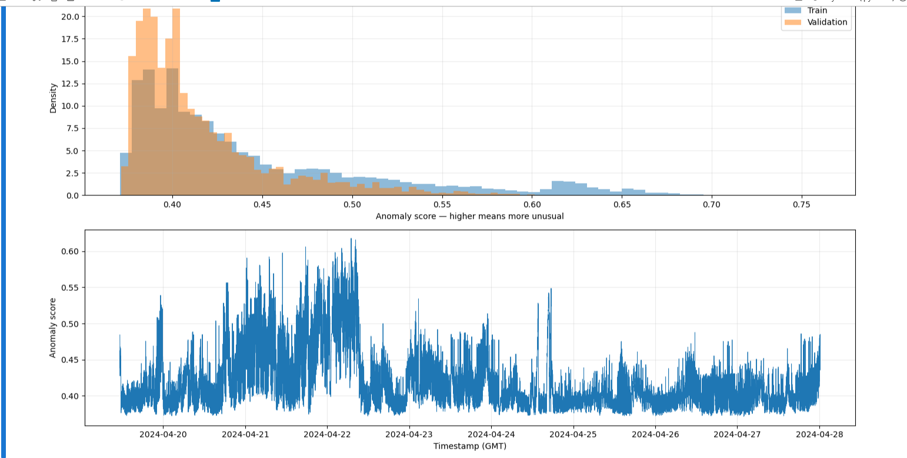
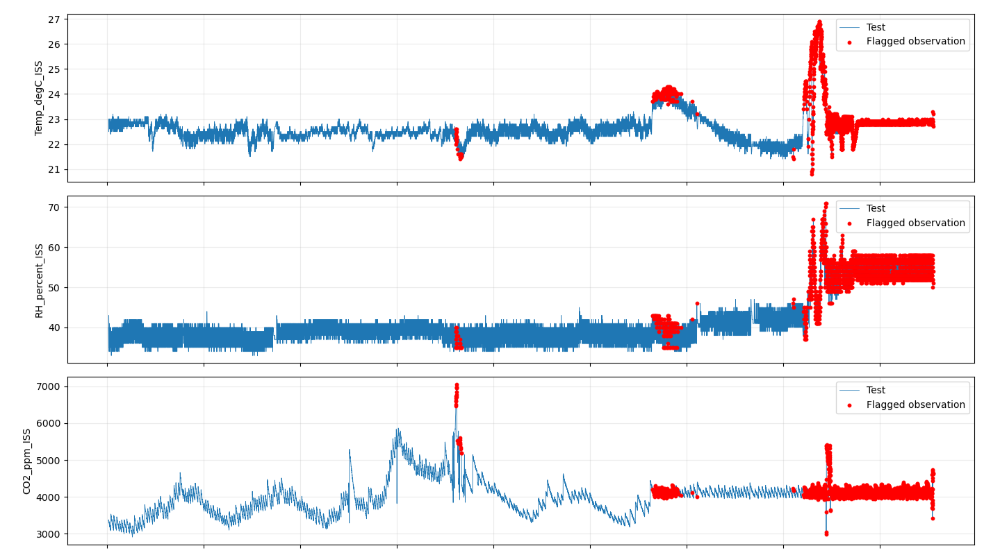
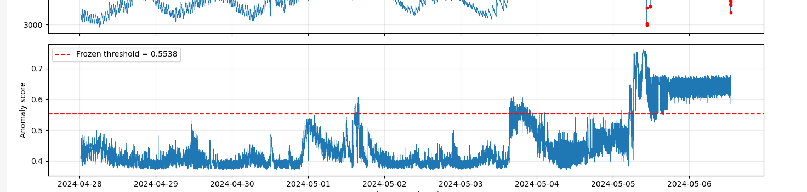
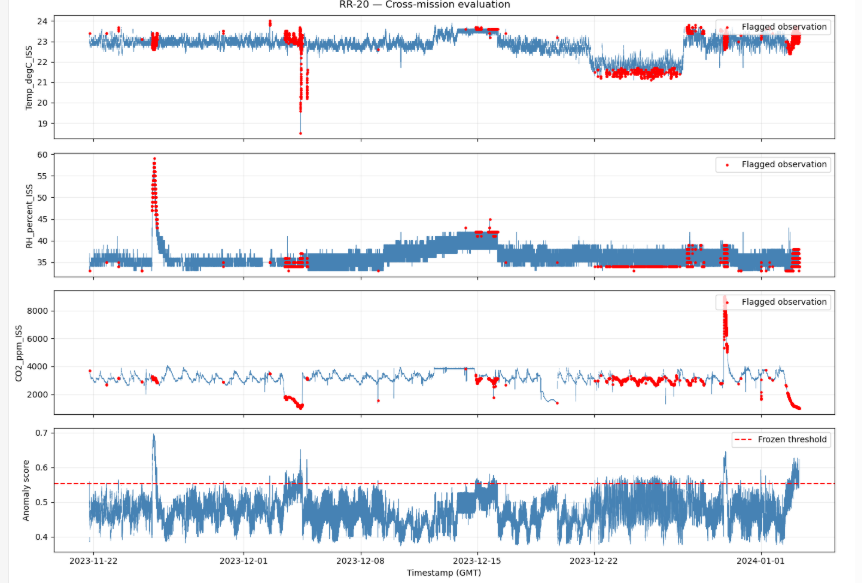
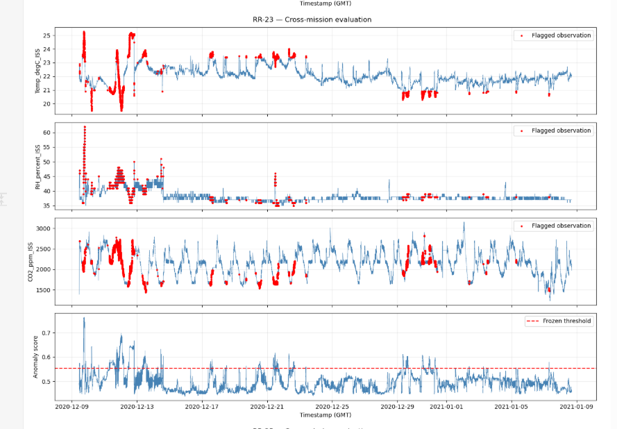
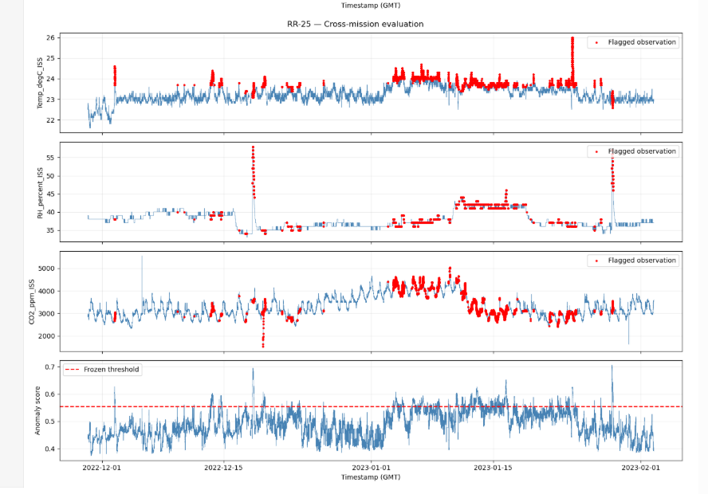
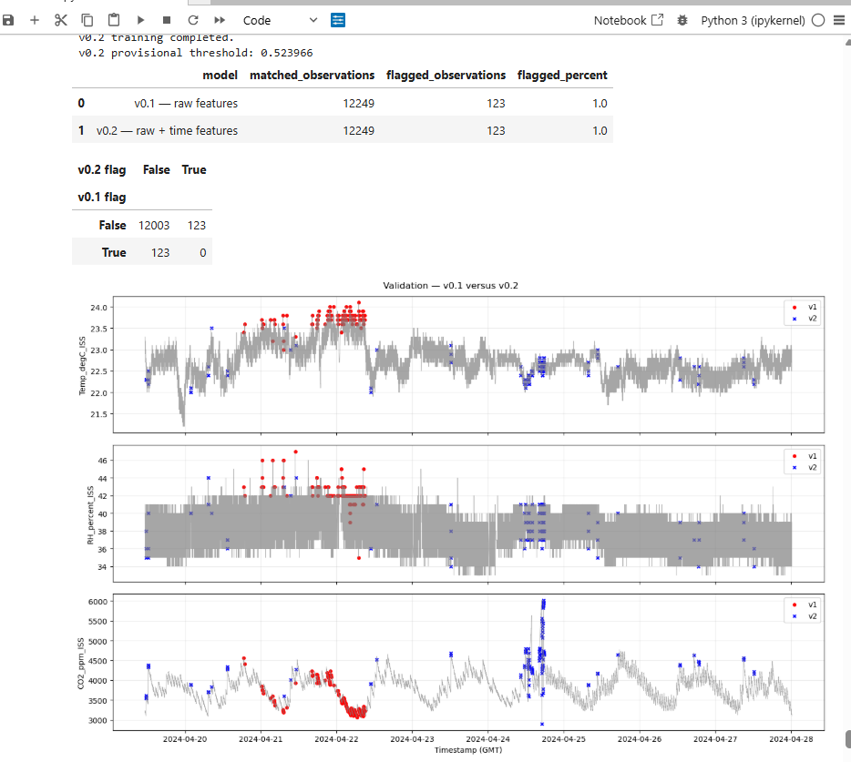

# Environment Anomaly ML and Rule Engine

## Overview

This project is a Python prototype for finding unusual patterns in environmental time-series data and showing clear, rule-based health-review evidence.

It works with environmental telemetry data such as:

- Temperature
- Relative humidity
- Carbon dioxide (CO₂)
- Timestamp data

The purpose is to support human review by showing unusual readings and possible patterns. It is not a medical diagnosis system, a safety-control system, or a replacement for professional review.

---

## NASA Environmental Data Source

The environmental data research was based on the NASA Open Science Data Repository (OSDR) Environmental Data App.

[NASA OSDR Environmental Data App](https://visualization.osdr.nasa.gov/eda/)

The source contains environmental telemetry values such as CO₂, temperature, and relative humidity.

---

## Data Cleaning and Preparation

Before training the anomaly model, the data was prepared using Python.

The main preparation steps were:

1. Load environmental data from CSV files.
2. Check that required columns are available.
3. Convert timestamps into a consistent date and time format.
4. Convert temperature, humidity, and CO₂ values into numeric values.
5. Handle missing or invalid values.
6. Sort records from oldest to newest.
7. Separate records into training, validation, and test data.
8. Keep validation and test records separate from training records.

---

## Anomaly Detection Model

The anomaly detection model learns the usual patterns in the training data. It then gives each environmental record an anomaly score.

A higher anomaly score means that the reading looks more unusual when compared with the patterns learned from the training data.

The model considers environmental features such as:

- Temperature
- Relative humidity
- CO₂ level
- Time-related features in version 0.2

The anomaly score is used as a screening signal. It does not prove that a problem exists.

---

## Validation and Threshold Selection

The model was checked using validation data that was kept separate from the training data.

A threshold was selected from the validation results. Readings above the threshold are marked as flagged observations for review.

The red points in the charts are flagged observations. They show places where the model found patterns that were unusual compared with its learned baseline.

The chart below shows the selected validation threshold.

---

## Test Results

After selecting the threshold, the model was applied to separate test data.

The threshold was frozen before testing. This helps make the test review more fair because the test data was not used to choose the threshold.

---

## Cross-Mission Evaluation

The anomaly-screening approach was also reviewed on environmental records from different mission datasets.

These charts show that environmental patterns can change across missions. The same threshold can highlight unusual behavior, but results still need human interpretation and context.

### RR-20 Evaluation

### RR-23 Evaluation

### RR-25 Evaluation

---

## Model Comparison

Two prototype model versions were compared.

- **Version 0.1:** uses raw environmental features.
- **Version 0.2:** uses raw environmental features and time-related features.

The comparison checks whether the newer feature set changes which observations are flagged during validation.

---

## Explainable Rule Engine

The project also includes a Python rule engine for health-review support.

Instead of making hidden decisions, the rule engine uses clear `if` rules. For example, it can show a possible review pattern when:

- Low wellbeing appears with headache
- Short sleep appears with fatigue
- Symptoms appear together with unusual environmental context
- Important information is missing from a check-in

Each result can create an evidence card that explains:

- Why the pattern was shown
- Which answers or readings supported it
- Which information was missing
- Why human review may be useful

The rule engine does not diagnose illness, prescribe treatment, or make a final medical decision.

---

## Responsible Use and Limitations

This is a prototype for anomaly screening and explainable review support.

- A flagged reading is not proof of a safety issue.
- A health pattern is not a diagnosis.
- Environmental conditions alone cannot prove the cause of a symptom.
- Results should be reviewed by qualified people with full context.
- The project uses historical or simulated/replay data for demonstration.

---

## Technologies Used

- Python
- Pandas
- NumPy
- Scikit-learn
- Matplotlib
- Jupyter Notebook
- CSV environmental time-series data
- Git and GitHub

---

## Data Attribution

Environmental data research was based on the NASA Open Science Data Repository (OSDR) Environmental Data App:

[NASA OSDR Environmental Data App](https://visualization.osdr.nasa.gov/eda/)

This repository is a portfolio prototype and is not an official NASA product.
