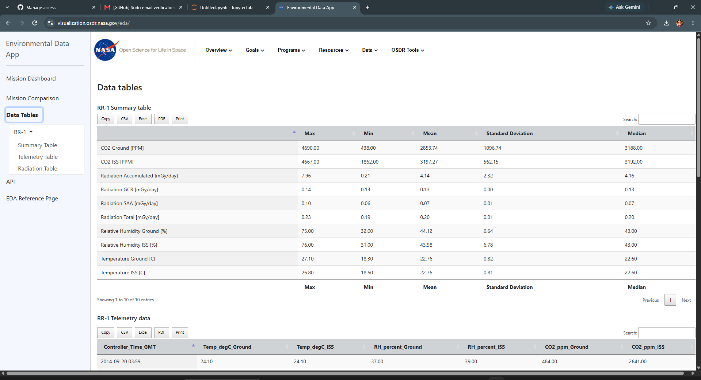
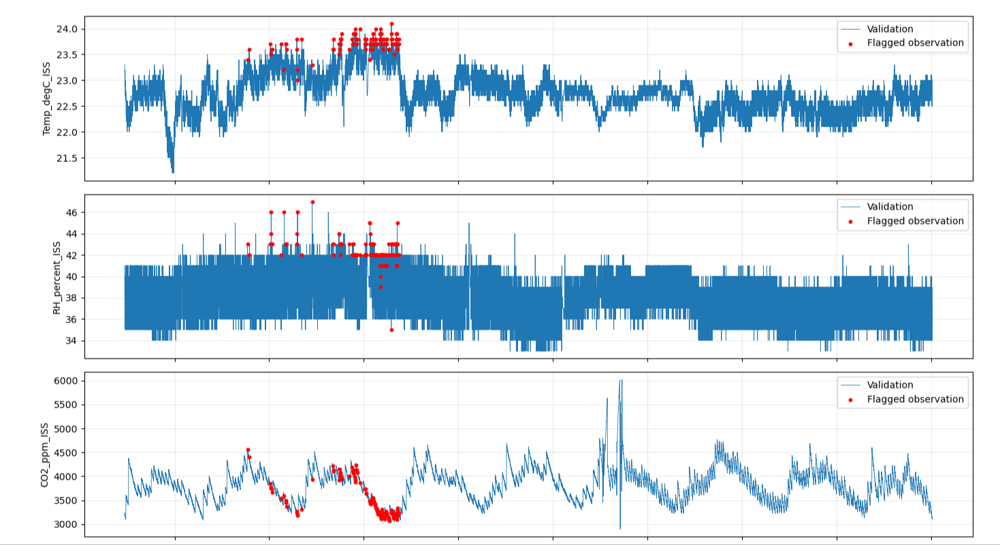
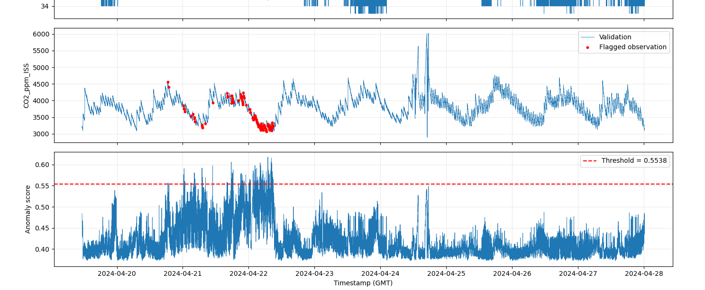

# Environment Anomaly ML and Rule Engine

## Overview

This project is a Python prototype for finding unusual environmental patterns and showing explainable health-review rules.

It uses environment data such as:

- Temperature
- Relative humidity
- Carbon dioxide (CO₂)
- Timestamp

The project is designed to support human review. It does not make medical diagnoses, prescribe treatment, or make automatic safety decisions.

---

## NASA Environmental Data Source

The environmental data research was based on the NASA Open Science Data Repository (OSDR) Environmental Data App.

NASA OSDR Environmental Data App:  
https://visualization.osdr.nasa.gov/eda/

The source contains environmental telemetry values such as CO₂, temperature, and relative humidity.

---

## Data Cleaning and Preparation

Before training the anomaly model, the data was prepared using Python.

The main preparation steps were:

1. Load environment data from CSV files.
2. Check required columns.
3. Convert timestamps into a consistent date and time format.
4. Convert temperature, humidity, and CO₂ values into numeric values.
5. Handle missing or invalid values.
6. Sort records from oldest to newest.
7. Separate the records into training, validation, and test data.
8. Keep validation and test records separate from training records.

---

## Anomaly Detection Model

The model learns common patterns from environment data. It then gives every record an anomaly score.

A higher anomaly score means that a reading appears more unusual when compared with the learned pattern.

The model uses features such as:

- Temperature
- Relative humidity
- CO₂
- Time-based features

---

## Validation and Threshold Selection

Validation data was used to review anomaly scores and select a provisional threshold.

Records above the threshold are marked as flagged observations. A flagged observation does not prove that a dangerous event happened. It only means that the reading looks unusual and may need human review.

---

## Test Evaluation

After choosing the threshold, the same frozen threshold was applied to separate test data.

This helps check model behavior on records that were not used during training or threshold selection.

---

## Cross-Mission Evaluation

The anomaly model was also reviewed on different mission records. This shows how the model behaves when environment patterns change across missions.

![Cross-mission evaluation RR-25](
